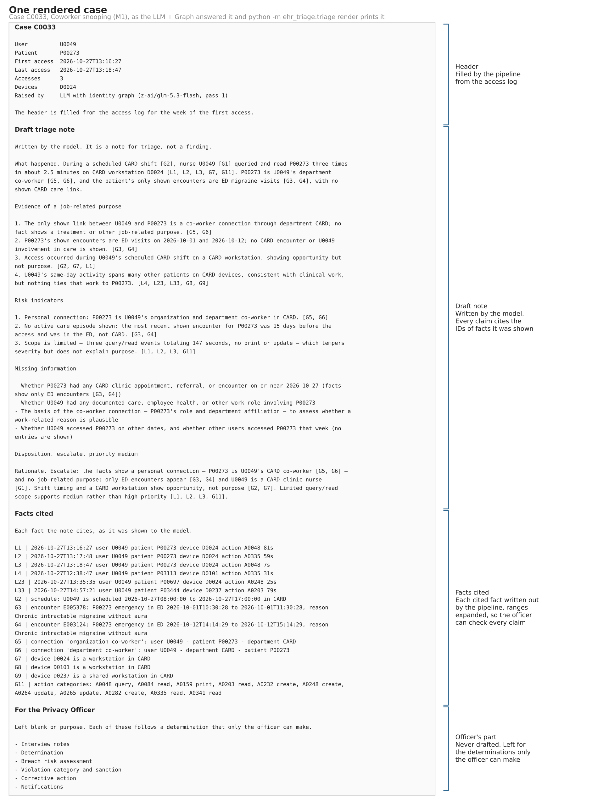
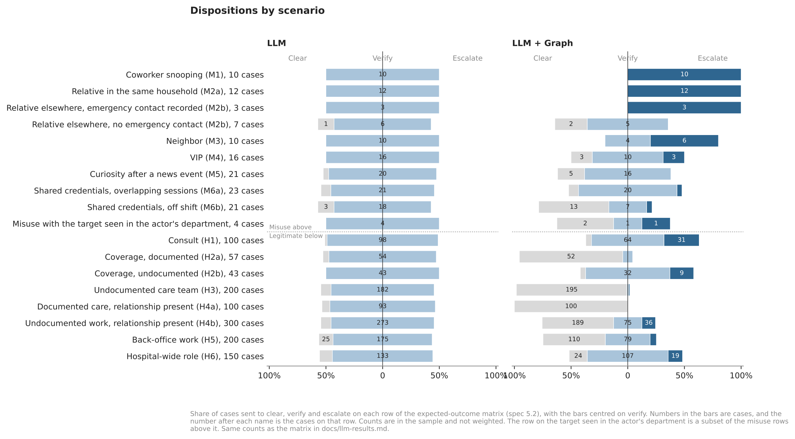
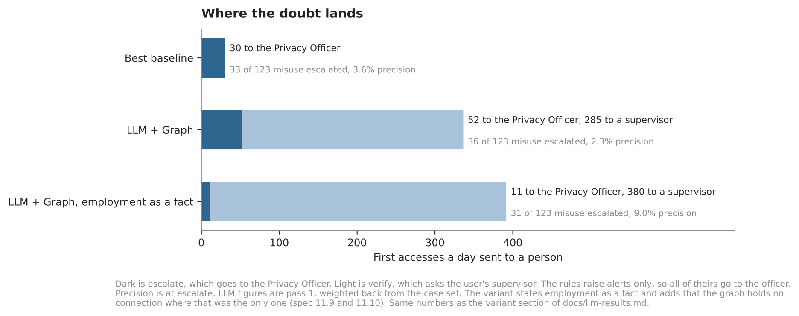

*Given only audit logs, the model couldn't triage. Given an identity graph, it matched two simple rules, and how it was told about patients who are also staff decided whether its doubtful cases reached the Privacy Officer or a supervisor.*

On a Tuesday afternoon, a cardiology nurse opens a colleague's chart three times in under three minutes, then moves on to the next patient. Nothing in the hospital's records explains it. The colleague's only recent visits were to the emergency department, and the nurse had no part in them.

Someone has to decide whether that was snooping. Detecting suspicious access to electronic health records (EHR) has been studied for over a decade. Explanation-based auditing, from Fabbri and LeFevre, explains most accesses automatically by finding a path in the record that ties the user to the patient, such as an appointment or an order. Once repeat accesses are set aside, their method explains over 94% of all accesses, though only about 4 in 10 of the ones opened for the first time.

What's left still lands on a Privacy Officer's desk. Each unexplained access has to be looked into and written up, and that step has had far less attention. I wanted to know whether an LLM could take the first pass, reading the evidence, deciding whether the access needs a closer look and drafting the note an officer would start from.

*Figure 1. The note the model drafted for the nurse's access. Every claim cites the facts it rests on. The officer's part, from the determination to any sanction, is left blank on purpose.*

This one was right. The nurse's access was planted as coworker snooping, and the model escalated it. Like every case in this project, it comes from a synthetic hospital, so I know the true reason behind every access. The rest of this article is about when the model gets it right, when it doesn't, and how much depended on the way one fact was stated.

## A hospital built to be tested

There is no public dataset of EHR access logs to test this on. The studies that shaped the field each used one hospital's private logs. The one recent real log I found has no roles, departments or relationships, which is exactly what snooping turns on. So I built a hospital.

Patients come from Synthea, an open-source generator of synthetic patient records. Staff, schedules, care teams, orders and workstations are generated around them. The result has about 400 staff, 3,500 patients and 676,000 accesses over 30 days. It is tuned to published audit-log studies, with 393 accesses per staff member a week against a published 375-580, and self-access at the published 0.3%. Where it misses a target, the gap is reported rather than tuned away. The one that matters later is that staff here open a colleague's chart about three times as often as in the published data. Two other gaps are worth knowing. The rule for coworkers in the same department matches about 30 times as often as published, and departmental work explains 27% of first accesses against a published 41%.

On top of ordinary work I planted misuse by scenario. Coworker snooping, a relative in the same household or elsewhere, a neighbor, a VIP, curiosity after a news event, and two people sharing one login. I also planted legitimate work built to look like misuse, the kind that fills an officer's queue with false alerts. Consults with nothing on record, undocumented coverage for a colleague, back-office staff, and roles that span the whole hospital.

The unit of triage is a first access, one user opening one patient's chart for the first time in a week, as in the papers I compare against. The month has 63,872 of them, and 123 are misuse, fewer than 1 in 500.

Every patient, staff member and access is synthetic. No real patient data and nothing derived from any real system went into it. In the repo, each parameter names its published source, or is marked as my own assumption where there is none.

## Four systems, one set of cases

I compared four systems on the same accesses.

1. **Rules.** The five relationship rules Hedda et al. evaluated at Vanderbilt. User and patient work in the same organization or department, share a last name, live within a quarter mile or live on the same street. An alert is a rule that fires.
2. **Templates.** Explanations in the style of Fabbri and LeFevre. An access is explained by a care-team assignment, an order, or work the user's department routinely does. An alert is an access with nothing to explain it.
3. **LLM.** GLM 5.3 Flash, served through OpenRouter on a 4-bit endpoint, shown only the log lines around the access, without anyone's role, where a device sits or what an action code means.
4. **LLM + Graph.** The same model, shown the same lines plus facts from an identity graph. The user's role and shifts, the patient's encounters, every named connection between the two, and what each device and action code is. The patient's encounters are listed whatever their date, so the model can see visits that came after the access, as an officer reviewing it later would.

The best baseline combines the first two, as Hedda et al. propose. A rule fires, and the alert is dropped when direct evidence explains the access. It raises about 30 alerts a day and catches 33 of the 123 misuse accesses. That's the bar.

Both LLM systems answer clear, verify or escalate. Clear leaves the access alone, verify asks the user's supervisor, and escalate sends it to the Privacy Officer. Each also drafts a note like the one in figure 1, where every claim has to cite the facts it rests on. Both were sent the same 1,673 cases, all 123 misuse accesses plus a fixed sample of each kind of legitimate work, and the results are weighted back to the whole month.

Before anything ran, I wrote down what each system should do on each scenario, and fixed the rule that scores those predictions before the passes reported here.

Then I had the repository reviewed by a model from another lab, given none of my notes and asked to look for leaks, circular results and claims the numbers don't support. It found no leaks. It did find that my first pass credited care-team and order records whatever their date, and showed the model the first log lines of the week rather than the nearest ones. I fixed the inputs and ran everything again. The first pass stays in the repo, labeled exploratory, and nothing below comes from it.

## What I learned

### From log lines alone, it can't triage

Shown log lines alone, the model escalated none of the 123 misuse accesses, in either pass. Instead it sent 89% and 93% of all first accesses to verify in its two passes, misuse and legitimate work alike. Counting verify as an alert, its precision was 0.2%, the share of misuse in the data. A system with no information at all would do the same.

For the nurse in figure 1 it answered verify, noting that nothing it was shown gave the nurse's role or any tie to the patient. That was true. It just answered the same way to almost everything. That says the missing context matters to this model, not that a graph is the only way to supply it.

### With grounding, it sees relationships, not behavior

Given the identity graph, the same model escalated all 10 coworker cases, all 12 relatives in the same household, and every relative elsewhere whose emergency contact was on record. It flagged all 10 neighbor cases, 6 of them at escalate. It also cleared documented care almost every time, 198 of 200 accesses explained by an order or care team and all 100 where a relationship sat alongside documented care.

It did not escalate any of the 21 accesses made out of curiosity after a news event, even though each prompt showed another user opening the same patient after the news. It cleared 13 of 21 accesses made with a shared login outside the owner's shift, while being shown that the owner wasn't on shift.

The pattern is clear. The relationships it was shown are the ones that define the scenarios it caught, so part of that success is built in. Misuse that only shows across users or sessions, it doesn't treat as a concern. That may be because it judges one access at a time, though I didn't test it. Legitimate work with no documented purpose mostly went to verify, which the prompt allows when no purpose is on record, so that's a fair answer. The real errors there are escalations, and those come next.

*Figure 2. What each system answered, scenario by scenario. Without the graph almost every bar is verify. With it, relationship misuse moves to escalate and documented care to clear, while news-event and shared-login misuse stays at clear or verify.*

### It tied the baseline, with more alerts

The grounded model escalated 36 of the 123 misuse accesses. The best baseline caught 33. They didn't catch the same ones. The model caught 8 the baseline missed, such as relatives with a recorded emergency contact, and the baseline caught 5 the model left at verify. A difference that small could be chance.

The model got there with more alerts, about 52 a day against the baseline's 30. For a team that can review 10 alerts a day, the baseline finds about 16 misuse accesses in a month and the model about 6. As first built, the grounded LLM was not better than two simple rules in a row.

*Figure 3. Each system as one point, alerts a day against misuse caught. The grounded model sits beside the best baseline with a few more catches and more alerts.*

### How it was told about staff caused most of the extra alerts

Splitting the alerts by whose chart was opened explains most of the gap. About 43 of the model's 52 alerts a day fell on charts of patients who are also staff. On every other chart it raised 8 a day against the baseline's 10 and caught 21 misuse accesses against 22.

On staff charts, legitimate work with no documented purpose was escalated 50 times out of 68. That covers consults, coverage, back-office work and hospital-wide roles. On other charts the same kinds of work were almost never escalated, 0 of 178 back-office accesses and 2 of 130 hospital-wide ones.

The notes showed why. The graph described employment as an "organization co-worker" connection between user and patient, and the prompt gave "a personal connection with no job-related purpose" as its example of a concern. So a staff chart opened without a documented reason read as exactly that. The note in figure 1 says it outright, listing "Personal connection" as its first risk. There it was right. On most staff charts it wasn't.

So I changed how employment is stated. Where the patient is staff, the prompt now says "patient P is a member of staff, in department D" instead of listing a co-worker connection. Where that was the only connection, it also says the graph holds no connection between the two. That second line appears in 66 of the 68 cases below, so the test can't say which change did the work. A shared department still shows as a connection. Before running it, I wrote down what would count as a real effect on those 68 cases. Fewer escalations than in either original pass, a difference that chance would rarely produce, and more change than rerunning alone causes.

It passed all three by a wide margin. The reworded model escalated 8 of the 68, against 50 and 55 in the original passes, and 4 in its own second pass. Its escalations to the Privacy Officer fell from 52 a day to 11, and their precision rose to 9%, against the baseline's 3.6%. Within a budget of 10 alerts a day it found about 23 misuse accesses in the month, against the baseline's 16. It still escalated all 10 coworker cases, and 9 of 10 in its second pass.

Those cases didn't disappear, though. They moved to verify, which asks the user's supervisor. The supervisor queue grew from about 285 accesses a day to 380, so the reworded model asks a human about 390 times a day, against 336 before and the baseline's 30. Whether a supervisor's quick check costs less than an officer's review is a fair question, and I didn't measure it. What the rewording changed is where the doubt lands, not how much of it there is.

It paid for that on staff patients. It caught 31 misuse accesses against the original 36, slightly fewer than the baseline's 33. The losses were mostly misuse aimed at staff, such as three accesses to a VIP who is also on staff.

I found this rewording by studying these same cases, so it's a development result, not a held-out one. The second pass rules out a lucky run, not a lucky choice. The calibration gap from earlier doesn't explain it away either. Weighted down to the published share of staff charts, the reworded model raises about half the baseline's alerts, 8 a day against 16, at nearly twice its precision. That check keeps the misuse count fixed, so it also makes misuse a larger share of the month.

*Figure 4. Share of legitimate work escalated by the grounded model, on staff charts and on other charts, by kind of work. Work with no documented purpose is escalated mostly when the patient is staff.*

*Figure 5. Escalations and supervisor checks a day, misuse caught and precision for the original wording, the rewording and the best baseline.*

### Its notes cite what they were shown

All but 5 of the grounded model's 10,957 claims cite facts that were actually in its prompt. A second model, DeepSeek V4.1 Flash, then judged whether each claim was supported by the facts it cites. It rated 65% supported, 32% partly supported and under 2% unsupported.

I didn't take the judge at its word. Claude, the assistant I built this project with, reread 36 of its verdicts blind. None of the 12 claims it called supported turned out wrong, but its "unsupported" held up only once in 12. Most of those were plain statements it rejected anyway. Only 2 of the 36 claims read were actually wrong. So the notes stick to their evidence, and the judge's "unsupported" figure should not be read as an error rate. The judge rated the reworded model's notes about the same, though the blind reread didn't include them.

### One answer is one draw

I sent every case twice with the same prompts at temperature 0. About 1 case in 6 got a different answer the second time, nearly always moving one step, between clear and verify or between verify and escalate. The totals barely moved, 36 then 35 misuse accesses escalated. The least stable cases were the ones the model was least sure about, back-office work and consults. A single answer on a single case is something to read, not a decision.

The same comparison settles covering accesses. In a known attack on detectors, from Xu et al., the snooper opens similar charts around the target to blend in. Adding those covers changed whether a target was escalated 7 and 5 times out of 58, while rerunning alone changed 5 and 3. I saw no sign that the covers hid anything, though 58 targets can only show a large effect.

## Limitations

This is one model on one synthetic hospital. GLM 5.3 Flash was served with 4-bit weights, so the results may not carry over to the same model at full precision, let alone to other models. The hospital opens staff charts about three times as often as the published data, and every count on staff charts carries that gap.

The misuse is thin. The 123 misuse accesses come from 62 planted incidents, and some share a source. The 21 news-event accesses come from two news events, and the 44 shared-login accesses from 10 shared logins. Each system ran twice, which shows how much answers move, not how they would move over many runs.

The rewording was found on the cases it was then tested on, and a fresh hospital is the test that would settle it. The judge was checked by a second model on 36 claims, not by a person, so no error rate is given. The review budgets are averaged over the month rather than simulated day by day. The seven-day window for counting care as evidence and the 15 minutes that define two sessions overlapping are my own assumptions, with no published source behind them.

A second outside review added two more. The log-lines model is missing more than the graph, since it also lacks roles and what devices and actions mean, so the comparison shows that context matters, not that a graph is the only way to give it. And some generated details don't match their description in the spec. Most consults fall outside the consultant's shifts, and the time recorded for an access isn't always the time until the user's next one. The repo lists these in full.

## What I'd do differently

I'd match the share of staff charts to the published data before the first run. I left the gap visible on purpose, but it made the most interesting result harder to read, since part of it rests on a number I already knew was off.

I'd generate a second hospital from a different seed on day one and leave it untouched. Then a change like the rewording could be tested the moment I found it, instead of becoming the open question at the end of the article.

And I'd fix the scoring rule before any model ran. I wrote my predictions first, but the rule that decides whether a prediction held came after the exploratory pass. It was fixed before the passes reported here, so the results stand, but it's the kind of order that should never need explaining.

## What's next

The first step is a fresh test on a new hospital, changing the two statements one at a time. After that, the misuse the reworded model now leaves at verify points somewhere interesting. Some hospitals already ask staff to give a reason before opening a colleague's chart. Putting that reason in front of the model could turn a missing purpose into a recorded one, and that's worth building next.

For anyone building something like this today, the lessons are short. Don't expect a model to triage from log lines alone. Word the facts you give it with care, because how employment was stated decided where most of the doubtful cases went. And count every queue a change creates, not just the one it shrinks. Expect it to reproduce much of what rules and explanations already do, and treat each answer as a suggestion to read rather than a decision.

The code, every model answer and the full statistical reading are in the [repository](https://github.com/carlosadelavega/ehr-access-triage), and every number here is generated from them. The passes reported here cost under 9 USD in model calls. I built this project with Claude as a coding assistant. The research question, the design decisions and the reading of the results are mine, and the README records who decided what.
