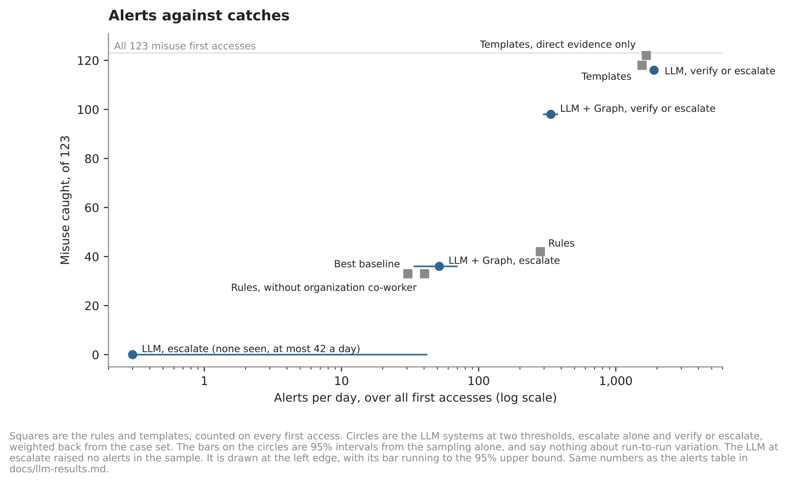
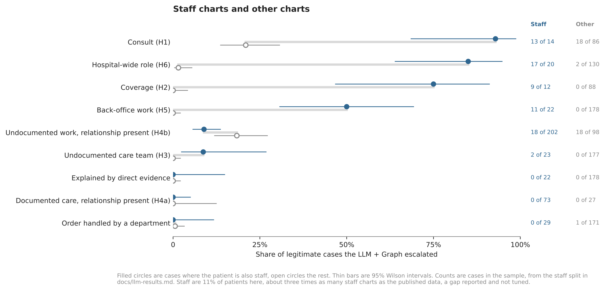

*On synthetic EHR logs, this model mostly deferred without identity context. With context, it escalated a similar number of misuse cases to a simple baseline. Changing two statements about staff status reduced Privacy Officer escalations but increased supervisor checks, leaving the overall workload benefit unproven.*

In a synthetic hospital, a cardiology nurse opens a colleague's chart three times in under three minutes, then moves on to the next patient. The records shown offer no work-related explanation. The colleague's only recent visits were to the emergency department, with no recorded involvement by the nurse.

Someone has to decide whether that was snooping. Detecting suspicious access to electronic health records (EHR) has been studied for over a decade. Explanation-based auditing, from Fabbri and LeFevre, explains most accesses automatically by finding a path in the record that ties the user to the patient, such as an appointment or an order. Their method explains over 94% of all accesses, while explaining about four in ten first accesses.

What's left still lands on a Privacy Officer's desk. Each unexplained access has to be looked into and written up, and that step has had far less attention. I wanted to know whether an LLM could take the first pass, reading the evidence, deciding whether the access needs a closer look and drafting the note an officer would start from.

Here is an abridged view of the model's note for the nurse's access.

> **Disposition** Escalate, medium priority.
>
> **Evidence** The patient is a colleague, with no documented care relationship to the nurse.
>
> **Rationale excerpt** "Shift timing and a CARD workstation show opportunity, not purpose [G2, G7]."

[Read the full generated note and its cited facts (figure 1).](/assets/img/fig1-rendered-case.png) The officer's part, from the determination to any sanction, is left blank on purpose.

The escalation was right against the synthetic label. I had planted this access as coworker snooping. The rest of this article is about when the model gets that decision right, when it doesn't, and how much depended on the way staff status was stated.

## A hospital built to be tested

I found no public dataset with both the access logs and the relationships needed for this experiment. The studies that shaped the field each used one hospital's private logs. One recent real log, described in a preprint, lacks roles, departments and relationships. So I built a hospital.

Patients come from Synthea, an open-source generator of synthetic patient records. Staff, schedules, care teams, orders and workstations are generated around them. The result has about 400 staff, 3,500 patients and 676,000 accesses over 30 days. It is tuned to published audit-log studies, with 393 accesses per staff member a week against a published 375-580, and self-access at the published 0.3%. Where it misses a target, the gap is reported rather than tuned away. The one that matters later is that staff here open a colleague's chart about three times as often as in the published data. Two other gaps are worth knowing. The rule for coworkers in the same department matches about 30 times as often as published, and departmental work explains 27% of first accesses against a published 41%.

On top of ordinary work I planted misuse by scenario. Coworker snooping, a relative in the same household or elsewhere, a neighbor, a VIP, curiosity after a news event, and two people sharing one login. I also planted legitimate work built to look like misuse, the kind that fills an officer's queue with false alerts. Consults with nothing on record, undocumented coverage for a colleague, back-office staff, and roles that span the whole hospital.

The unit of triage is a first access, one user opening one patient's chart for the first time in a week, as in the papers I compare against. The month has 63,872 of them, and 123 are misuse, fewer than 1 in 500.

Every patient, staff member and access is synthetic. No real patient data and nothing derived from any real system went into it. The calibration config names each parameter's published source, or marks it as my own assumption where there is none.

## Four systems, one set of cases

I compared four systems on the same accesses.

1. **Rules.** The five relationship rules Hedda et al. evaluated at Vanderbilt. User and patient work in the same organization or department, share a last name, live within a quarter mile or live on the same street. An alert is a rule that fires.
2. **Templates.** Explanations in the style of Fabbri and LeFevre. An access is explained by a care-team assignment, an order, or work the user's department routinely does. An alert is an access with nothing to explain it.
3. **LLM.** GLM 5.3 Flash, served through OpenRouter on a 4-bit endpoint, shown only the log lines around the access, without anyone's role, where a device sits or what an action code means.
4. **LLM + Graph.** The same model, shown the same lines plus facts from an identity graph. The user's role and shifts, the patient's encounters, every named connection between the two, and what each device and action code is. The patient's encounters are listed whatever their date, so the model can see visits that came after the access, as an officer reviewing it later would.

The strongest baseline here combines relationship rules with an explanation filter, as Hedda et al. propose. It excludes the broad organization co-worker rule, keeps the other four rules, and drops an alert when direct evidence explains the access. It raises about 30 alerts a day and catches 33 of the 123 misuse accesses. That's the bar.

Both LLM systems answer clear, verify or escalate. Clear leaves the access alone, verify asks the user's supervisor, and escalate sends it to the Privacy Officer. The prompt also asks for a note like the one in figure 1, with claims tied to cited facts. Both systems were sent the same 1,673 cases, all 123 misuse accesses plus a fixed sample of each kind of legitimate work.

A few counting conventions matter. Unless I name a second pass, the numbers below are from pass 1. Misuse catches count first accesses across the 30-day period, not necessarily separate incidents. Daily LLM queues are estimates weighted from the sample back to the whole month. Precision is the share of a queue that is labeled misuse, and refers to escalations unless stated otherwise. Review-budget estimates use a ranking pooled across the month, not a simulated daily queue.

I wrote the scenario predictions before the exploratory run. The scoring rule that decides whether each prediction held came after that run, but before the corrected passes reported here. That chronology limits how strongly the prediction scores can be read as a test planned in advance.

An outside model review, given none of my notes, did not find direct label leakage. It did find that the exploratory pass credited care-team and order records whatever their date, and showed the model the first log lines of the week rather than the nearest ones. I fixed the inputs and ran everything again. The exploratory outputs stay in the repo, and nothing below comes from them.

## What I learned

### From log lines alone, it mostly deferred

Shown log lines alone, the model escalated none of the 123 misuse accesses, in either pass. Instead it sent 89% and 93% of all first accesses to verify in its two passes, misuse and legitimate work alike. Counting verify as a request for review, its precision was about 0.2%, close to the share of misuse in the data. It offered little selectivity at that threshold.

For the nurse in figure 1 it answered verify, noting that nothing it was shown gave the nurse's role or any tie to the patient. That was true. It just answered the same way to almost everything. That says the missing context matters to this model, not that a graph is the only way to supply it.

### With context, it escalated relationship cases more often

Given the identity graph, the same model escalated all 10 coworker cases, all 12 relatives in the same household, and every relative elsewhere whose emergency contact was on record. It flagged all 10 neighbor cases, 6 of them at escalate. It also cleared documented care almost every time, 198 of 200 accesses explained by an order or care team and all 100 where a relationship sat alongside documented care.

It did not escalate any of the 21 accesses made out of curiosity after a news event, even though each prompt showed another user opening the same patient after the news. It sent 16 of them to verify and cleared the other 5. It also cleared 13 of 21 accesses made with a shared login outside the owner's shift, while being shown that the owner wasn't on shift.

The relationships it was shown are the ones that define the scenarios it caught, so part of that success is built in. It rarely escalated the behavioral scenarios. Judging one access at a time may help explain that pattern, though I didn't test the explanation. Legitimate work with no documented purpose mostly went to verify, which the prompt allows. Escalations of that work are false positives against the synthetic labels, and those come next.

*Figure 2. Pass 1 answers, scenario by scenario. These are sample counts, without weighting. With context, relationship misuse moves to escalate and documented care to clear. News-event misuse stays at clear or verify, as does most shared-login misuse.*

### Similar catches, more escalations

The grounded model escalated 36 of the 123 misuse accesses. The best baseline caught 33. They didn't catch the same ones. The model caught 8 the baseline missed, such as relatives with a recorded emergency contact, and the baseline caught 5 the model left at verify. The paired test found no statistically significant difference in catches. That does not establish equivalence; it leaves a detection advantage unproven on these cases.

The model got there with more Privacy Officer escalations, about 52 a day against the baseline's 30 alerts. At an average budget of 10 reviews a day, the estimate is about 16 misuse accesses found in the month by the baseline and about 6 by the model. The original grounded model offered no demonstrated detection advantage over relationship rules followed by a direct-evidence filter, and required more officer reviews.

*Figure 3. Daily review estimates against misuse caught in pass 1. The two LLM thresholds count either escalations alone or escalations plus supervisor checks. Horizontal bars show uncertainty from sampling, not variation between model runs.*

### Changing two statements about staff reduced escalations

Splitting the results by whose chart was opened locates most of the gap. About 43 of the model's 52 escalations a day fell on charts of patients who are also staff. On other charts it escalated 8 a day against the baseline's 10 alerts and caught 21 misuse accesses against 22.

On staff charts, the model escalated 50 of 68 legitimate accesses spanning consults, coverage, back-office work and hospital-wide roles. The contrast was especially sharp for back-office work and hospital-wide roles. On other charts, it escalated none of 178 back-office accesses and 2 of 130 hospital-wide ones. Consults were less cleanly separated, with 18 of 86 on other charts escalated too.

The notes suggested an explanation. The graph described employment as an "organization co-worker" connection between user and patient, and the prompt gave "a personal connection with no job-related purpose" as its example of a concern. The note in figure 1 follows that pattern, listing "Personal connection" as its first risk. In that case the escalation matched the planted misuse. The same pattern also appeared in escalations of legitimate work.

So I changed how employment is stated. Where the patient is staff, the prompt now says "patient P is a member of staff, in department D" instead of listing a co-worker connection. Where that was the only connection, it also says the graph holds no connection between the two. That second line appears in 66 of the 68 cases below, so the test can't say which change did the work. A shared department still shows as a connection. Before running it, I wrote down what would count as a real effect on those 68 cases. Fewer escalations than in either original pass, a difference that chance would rarely produce, and more change than rerunning alone causes.

It passed all three by a wide margin. The reworded model escalated 8 of the 68, against 50 and 55 in the original passes, and 4 in its own second pass. Its escalations to the Privacy Officer fell from 52 a day to 11, and their precision rose to 9%, against the baseline's 3.6%. At an average budget of 10 reviews a day, the estimate rose to about 23 misuse accesses found in the month, against the baseline's 16. It still escalated all 10 coworker cases, and 9 of 10 in its second pass.

The supervisor queue grew from about 285 accesses a day to 380. Counting both queues, the reworded model requests roughly 390 human follow-ups a day, against 336 before and the baseline's 30. The change reduced Privacy Officer escalations while increasing supervisor checks and total cases requiring human follow-up. Whether that saves staff time depends on the cost of each kind of review, which I didn't measure.

It paid for that on staff patients. It caught 31 misuse accesses against the original 36, slightly fewer than the baseline's 33. The losses were mostly misuse aimed at staff, such as three accesses to a VIP who is also on staff.

I found this rewording by studying these same cases, so it's a development result, not a held-out one. The second pass reproduced the pattern on the same cases; it doesn't test whether the chosen wording transfers to new ones. A sensitivity check also retains the difference when legitimate staff-chart accesses are weighted down to the published share. The reworded model then raises about half the baseline's officer queue, 8 a day against 16, at nearly twice its precision. That check keeps the misuse count fixed, so it also makes misuse a larger share of the month.

*Figure 4. Share of sampled legitimate work escalated in pass 1, split by whether the patient is staff. The largest gaps are in consults, hospital-wide roles, coverage and back-office work; the pattern does not hold across every kind of legitimate access.*

*Figure 5. Pass 1 queue estimates, misuse escalated and escalation precision. The rewording shrinks the officer queue but grows the combined queue. These are case counts, not staff time.*

### Valid citations do not establish accurate notes

The citation check covers two fields, `purpose_evidence` and `risk_indicators`. All but 5 of the grounded model's 10,957 items in those fields cite facts that were actually in its prompt. That checks whether references exist, not whether they support the claim. A second model, DeepSeek V4.1 Flash, judged 10,914 of the items with valid citations. It rated 65% supported, 32% partly supported and under 2% unsupported. The narrative, missing-information field and rationale were not checked.

Claude, the coding assistant used on this project, then reread 36 claims without seeing the judge's verdicts, six from each verdict category for each of the two original LLM systems. It classified none of the 12 judge-supported claims as wrong, and agreed with only one of the 12 unsupported verdicts. In all, it classified two of the 36 claims as wrong. That is a second model's reading of a small, deliberately balanced sample, not human ground truth or an error rate. The reworded model received similar judge ratings, but was not included in this reread. The accuracy of complete notes remains unmeasured.

### One answer is one draw

I sent every case twice with the same prompts at temperature 0. For the original grounded model, about 1 case in 6 got a different answer the second time, nearly always moving one step, between clear and verify or between verify and escalate. The totals barely moved, 36 then 35 misuse accesses escalated. Back-office work and consults were among the least stable categories. A single answer on a single case is something to read, not a decision.

I also tested covering accesses, following an attack on detectors studied by Xu et al. The snooper opens similar charts around the target to blend in. Adding those covers changed whether a target was escalated 7 and 5 times out of 58 in the two passes, while rerunning alone changed 5 and 3. This found no clear aggregate covering effect in this setting. Two passes on 58 targets leave smaller effects unresolved.

## Limitations

This is one model on one synthetic hospital. GLM 5.3 Flash was served with 4-bit weights, so the results may not carry over to the same model at full precision, let alone to other models. The hospital opens staff charts about three times as often as the published data, and every count on staff charts carries that gap.

The misuse is thin. The 123 misuse accesses come from 62 planted incidents, and some share a source. The 21 news-event accesses come from two news events, and the 44 shared-login accesses from 10 shared logins. Each system ran twice, which shows how much answers move, not how they would move over many runs.

The rewording was found on the cases it was then tested on. A fresh hospital would test transfer to another synthetic population, not establish performance in a real one. The seven-day window for counting care as evidence is my own assumption. So is the 15-minute window used to look for nearby accesses on devices in different departments as a proxy for overlapping sessions; it does not establish actual session overlap.

A second outside review added two more. The log-lines model is missing more than the graph, since it also lacks roles and what devices and actions mean, so the comparison shows that context matters, not that a graph is the only way to give it. And some generated details don't match their description in the spec. Most consults fall outside the consultant's shifts, and the time recorded for an access isn't always the time until the user's next one. The repo lists these in full.

## What's next

Before more model calls, I'd correct the documented generator mismatches and bring staff-chart frequency closer to the published target through a declared configuration change. Then I'd freeze the scoring rules and generate a new hospital from a different seed, reserved for evaluation. The two employment statements need testing separately as well as together, with both queues counted. That would test whether the result transfers and which statement drives it.

Another experiment could supply a reason recorded by the user at access time. That would give the model evidence about purpose to assess. Whether it improves triage, and whether the reason is reliable, would need testing too.

In this experiment, context mattered, the wording of that context changed decisions, and fewer escalations did not mean fewer cases needing a person. Relationship rules with an explanation filter remained a useful comparison. Whether generated notes make that person's work faster or better is still an open question.

The code and saved model answers are in the [repository](https://github.com/carlosadelavega/ehr-access-triage), alongside the [full statistical results](https://github.com/carlosadelavega/ehr-access-triage/blob/main/docs/llm-results.md) and [judge review](https://github.com/carlosadelavega/ehr-access-triage/blob/main/docs/judge-review.md). The passes reported here cost under 9 USD in model calls. I built this project with Claude as a coding assistant. The research question, the design decisions and the reading of the results are mine.
